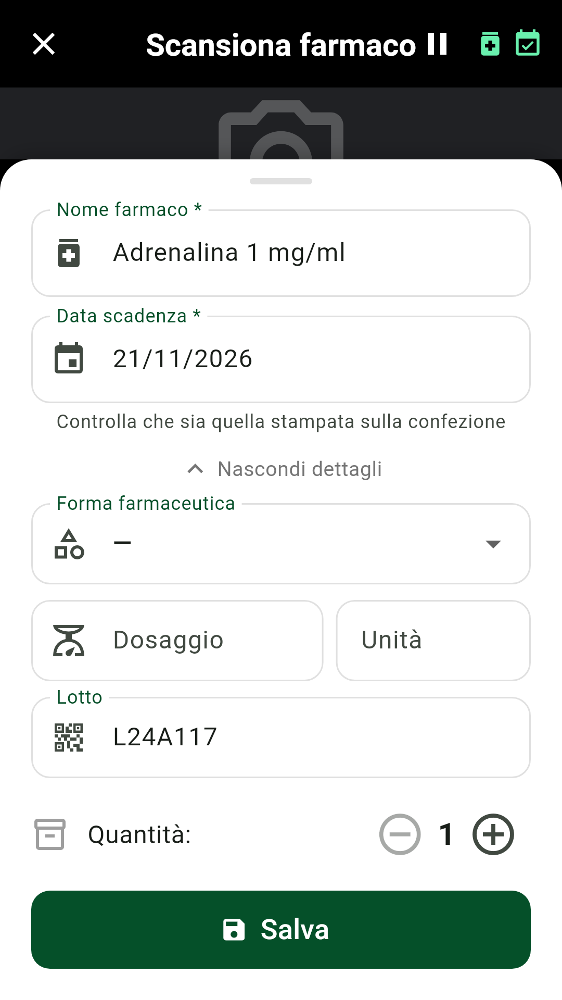
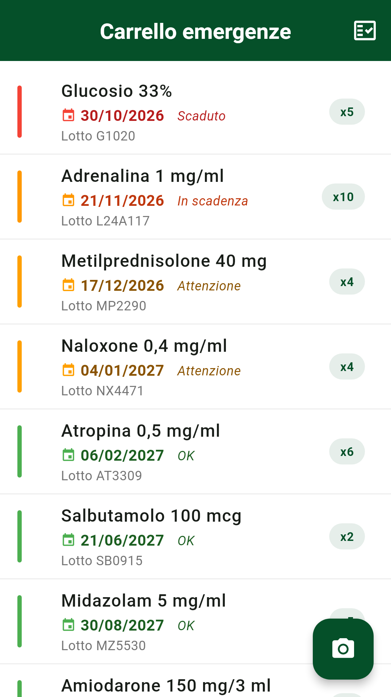
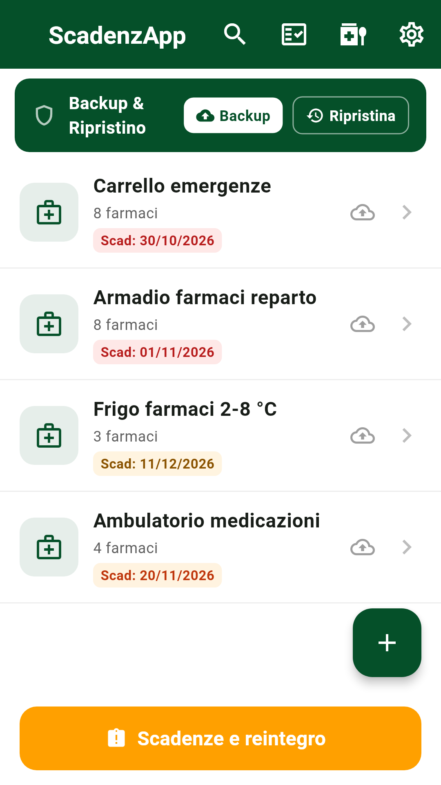
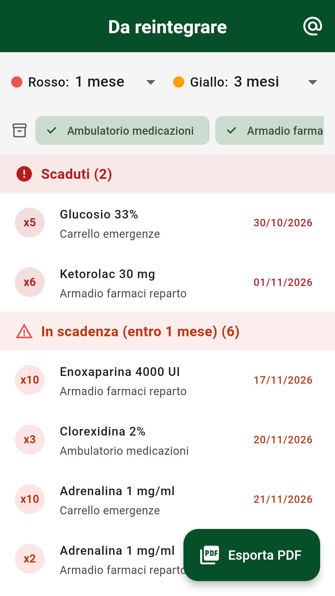
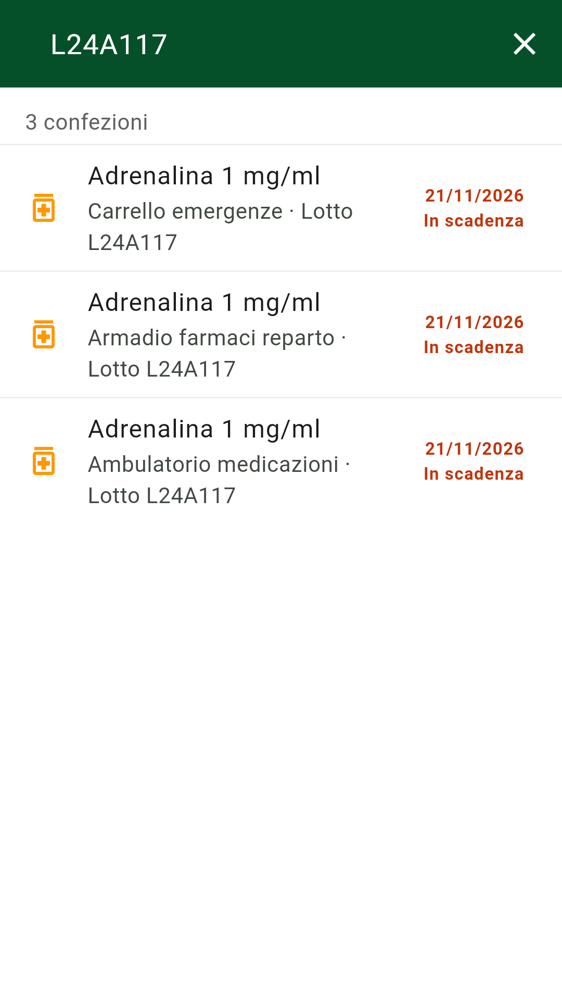
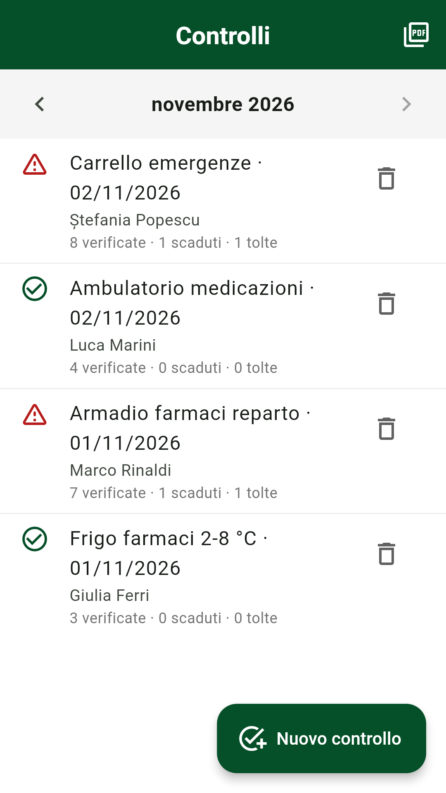
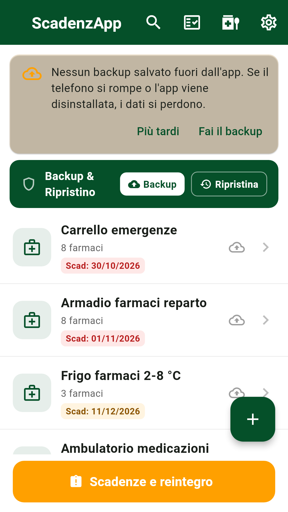
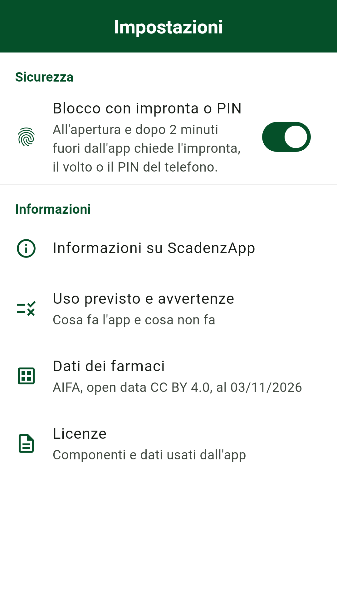
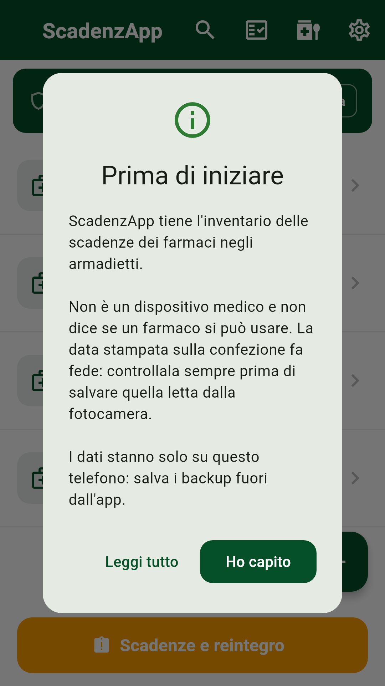

# ScadenzApp

**[English](#english)** · **[Italiano](#italiano)**

Medicine expiry inventory for ward, clinic and care home cabinets. · Inventario delle scadenze dei farmaci negli armadietti di reparto, ambulatorio e struttura.

Version 1.4.2 beta · Android 8.0 or later · not on Google Play: test builds are shared by hand.

<p align="center">
  <a href="https://github.com/Daveide90/scadenzapp/releases/latest/download/ScadenzApp.apk"></a>
</p>
<p align="center"><sub><a href="https://github.com/Daveide90/scadenzapp/releases">All versions, notes and SHA-256 · Tutte le versioni, note e SHA-256</a></sub></p>

<table>
<tr><td align="center" width="33%"></td><td align="center" width="33%"></td><td align="center" width="33%"></td></tr>
<tr><td align="center"><b>Scan</b> · Scansione</td><td align="center"><b>Cabinet</b> · Armadietto</td><td align="center"><b>Cabinets</b> · Armadietti</td></tr>
<tr><td align="center" width="33%"></td><td align="center" width="33%"></td><td align="center" width="33%"></td></tr>
<tr><td align="center"><b>Restock</b> · Reintegro</td><td align="center"><b>Batch search</b> · Ricerca per lotto</td><td align="center"><b>Checks</b> · Controlli</td></tr>
<tr><td align="center" width="33%"></td><td align="center" width="33%"></td><td align="center" width="33%"></td></tr>
<tr><td align="center"><b>Backup</b> · Backup</td><td align="center"><b>Settings</b> · Impostazioni</td><td align="center"><b>First start</b> · Primo avvio</td></tr>
</table>

<sub>Screens rendered from the app's own widgets with made-up data (`tools/schermate/`); in the scan screen the camera preview is replaced by a dark background. The app is in Italian. · Schermate generate dai widget dell'app con dati inventati; nella scansione l'anteprima della fotocamera è sostituita da uno sfondo scuro.</sub>

---

## English

ScadenzApp keeps track of medicine expiry dates in the cabinets of a ward, a clinic or a care home. You point the camera at the box, the app reads the expiry date and the batch number, and every cabinet shows in colour what expires and when. Everything stays on the phone: the app has no Internet access.

### What it does

| Feature | How it works |
|---|---|
| **Reading the box** | The camera reads the printed expiry date, the Data Matrix code (expiry and batch), the price sticker and the AIC code. Text recognition runs on the phone with Google ML Kit. The date must always be confirmed: the box is what counts. |
| **Medicine catalogue** | 12,680 medicines and 160,241 packs from the AIFA open data, included in the app: the AIC code gives name, form and strength. Missing medicines can be added by hand. |
| **Cabinets** | As many as you need (emergency trolley, fridge, clinic). Every medicine is coloured by expiry: expired, expiring, warning, fine. |
| **Reminders** | One notification a day, at 8:00, with the medicines that expire in 30 days, in 7 days or that day. Notifications do not show medicine names on the lock screen. |
| **Restock** | Every medicine to replace, from every cabinet, in three bands with thresholds chosen by the user. Exported as PDF, saved, or sent by email. |
| **Checks** | A log of who checked which cabinet and when, with the expired items removed and a note. Monthly PDF report with space for a signature. |
| **Search by name or batch** | Across all cabinets at once: when a batch is recalled you see at once where it is. |
| **Backup** | Full or per cabinet, encrypted with a password. Saved outside the app or shared; the app reminds you when the last backup is old. |
| **Lock** | Optional, with the phone's fingerprint, face or PIN; it locks again after 2 minutes away from the app. |

### Intended use and limits

ScadenzApp is an inventory tool. **It is not a medical device**: it gives no advice on diagnosis, therapy, dosage or administration. The date read by the camera can be wrong and must be checked on the box. The AIFA data carry the date of download and may miss later changes. The app does not receive batch recalls or safety alerts. Notifications depend on the phone's settings. Reports and lists do not replace the records and procedures of the organisation. The full text is in the app, under Impostazioni › Uso previsto e avvertenze ([`lib/legal/intended_use.dart`](lib/legal/intended_use.dart)).

### Privacy and security

| Aspect | How it is done |
|---|---|
| Network | No Internet permission in the manifest: the app cannot send anything. No account, ads, usage statistics or crash reports. |
| Data on the phone | Database encrypted with SQLCipher; the key is kept in the Android Keystore. |
| Automatic copies | Android backup and device-to-device transfer are off (`allowBackup="false"`, `dataExtractionRules`). |
| Backup | AES-256-CBC with HMAC-SHA256 (encrypt, then authenticate), key from PBKDF2-SHA256 with 600,000 iterations. |
| Screen | The app's content is hidden in the recent apps list and cannot be captured in a screenshot. |
| Permissions | Camera, notifications, biometrics, boot (to reschedule reminders), vibration. |

### How I approached security

**Secure by design.** ScadenzApp was built so that there is nothing to take from the outside: no Internet permission, no account, no server, no analytics. The data are encrypted on the phone (SQLCipher, key in the Android Keystore), backups are encrypted with a password, Android cloud backup and device transfer are off, and the screen cannot be captured.

**Hardened as far as I could.** Then I strengthened it step by step: authenticated backups (encrypt-then-MAC, PBKDF2 at 600,000 iterations, constant-time comparison), checks on imported backup files, a safe move from older unencrypted databases, an optional lock with fingerprint or PIN, no medicine names on the lock screen. Third-party libraries are checked against the public OSV vulnerability database: on 3 November 2026 SQLCipher (with its SQLite) and Guava were updated to close known CVEs.

**Tested with automated attacks by AI, in several rounds.** In repeated cycles, in June and November 2026, AI agents reviewed the code as an attacker would: reading the data without the key, forging or altering a backup, getting around the lock, crashing the app with crafted files. Every confirmed weakness was fixed, and where possible an automated test now reproduces the attack (for example a backup with an altered header or the wrong password), so that it cannot come back.

**Limits.** This is the work of a hobbyist with AI tools, not an independent professional audit or a certification: weaknesses may remain. If you find one, please report it privately (see [SECURITY.md](SECURITY.md)).

### Install

Tap **Download APK** at the top of this page on an Android phone (Android 8 or later), open the file and, when Android asks, allow installation from your browser or file manager. The app is not on Google Play yet. The SHA-256 fingerprint of each APK is in the release notes, to check that the file is the original.

### About the author

I am not a professional software developer: I am an enthusiast and I build apps in my spare time. ScadenzApp was written with the help of AI tools (Claude, by Anthropic), and I played an active role in its architecture, features, project direction, design and technical review. It was checked with automated tests and by hand on real phones, as carefully as I can. It is offered free of charge, as is, without any warranty (see the [LICENSE](LICENSE)). If you find a problem, please report it.

### Build

You need Flutter 3.44 and, for Gradle, Java 21.

```bash
flutter pub get
flutter test                       # all tests
flutter build apk --release --split-per-abi
```

The release signature reads `android/key.properties`, which is not in the repository.

| Tool | What it is for |
|---|---|
| `tools/genera_catalogo_aifa.py` | Rebuilds the catalogue from the AIFA open data; then update the date in `lib/app_info.dart` (a test checks it). |
| `tools/schermate/` | Rebuilds the screenshots of this page. |

### Licences and sources

The code is released under the [PolyForm Noncommercial License 1.0.0](LICENSE): anyone may read it, use it, change it and share it for noncommercial purposes, and hospitals, public bodies, schools and research institutions may use it whatever their funding. Commercial use requires a separate licence from the author, who keeps all other rights, including the name ScadenzApp. The medicine data belong to the **Italian Medicines Agency (AIFA)**, open data set «Confezioni dei farmaci», licensed [CC BY 4.0](https://creativecommons.org/licenses/by/4.0/); the app keeps only authorised packs, with names and strengths reorganised for search. AIFA is not involved in this project. The PDF typeface is Roboto (Apache 2.0). The licences of every component, Android libraries included, are in the app under Impostazioni › Licenze.

### Feedback

Problems and ideas: open an issue on this repository. Security problems: see [SECURITY.md](SECURITY.md). Security fixes are listed in the [CHANGELOG](CHANGELOG.md).

---

## Italiano

ScadenzApp tiene il conto delle scadenze dei farmaci negli armadietti di un reparto, di un ambulatorio o di una struttura. Si inquadra la confezione, l'app legge scadenza e lotto, e ogni armadietto mostra a colori cosa scade e quando. Tutto resta sul telefono: l'app non ha accesso a Internet.

### Cosa fa

| Funzione | Come funziona |
|---|---|
| **Lettura della confezione** | Con la fotocamera l'app legge la data di scadenza stampata, il Data Matrix (scadenza e lotto), il bollino e il codice AIC. Il riconoscimento del testo avviene sul telefono con Google ML Kit. La data va sempre confermata: la confezione fa fede. |
| **Catalogo dei farmaci** | 12.680 farmaci e 160.241 confezioni dagli open data AIFA, inclusi nell'app: dal codice AIC escono nome, forma e dosaggio. I farmaci che mancano si aggiungono a mano. |
| **Armadietti** | Quanti se ne vuole (carrello delle emergenze, frigo, ambulatorio). Ogni farmaco è colorato per scadenza: scaduto, in scadenza, attenzione, a posto. |
| **Avvisi** | Un solo avviso al giorno, alle 8, con i farmaci che scadono fra 30 giorni, fra 7 giorni o quel giorno. Le notifiche non mostrano i nomi sulla schermata di blocco. |
| **Reintegro** | Tutti i farmaci da sostituire di tutti gli armadietti, divisi in tre fasce con soglie scelte dall'utente. Si esporta in PDF, si salva, si manda per email. |
| **Controlli** | Registro di chi ha controllato quale armadietto e quando, con gli scaduti tolti e una nota. Report mensile in PDF con lo spazio per la firma. |
| **Ricerca per nome o lotto** | In tutti gli armadietti insieme: quando viene ritirato un lotto si vede subito dove sta. |
| **Backup** | Completo o per armadietto, cifrato con una password. Si salva fuori dall'app o si condivide; l'app ricorda quando l'ultimo backup è vecchio. |
| **Blocco** | Facoltativo, con impronta, volto o PIN del telefono; si richiude dopo 2 minuti fuori dall'app. |

### Uso previsto e limiti

ScadenzApp è uno strumento di inventario. **Non è un dispositivo medico**: non dà indicazioni su diagnosi, terapie, dosaggi o somministrazioni. La data letta dalla fotocamera può essere sbagliata e va controllata sulla confezione. I dati AIFA hanno la data del download e possono non comprendere variazioni successive. L'app non riceve ritiri di lotti né allerte. Le notifiche dipendono dalle impostazioni del telefono. Report e liste non sostituiscono i registri e le procedure della struttura. Il testo completo è nell'app, in Impostazioni › Uso previsto e avvertenze ([`lib/legal/intended_use.dart`](lib/legal/intended_use.dart)).

### Privacy e sicurezza

| Aspetto | Com'è fatto |
|---|---|
| Rete | Nessun permesso Internet nel manifest: l'app non può trasmettere nulla. Niente account, pubblicità, statistiche d'uso o segnalazioni di crash. |
| Dati sul telefono | Database cifrato con SQLCipher; la chiave sta nel Keystore di Android. |
| Copie automatiche | Backup di Android e trasferimento fra telefoni spenti (`allowBackup="false"`, `dataExtractionRules`). |
| Backup | AES-256-CBC con HMAC-SHA256 (cifra, poi autentica), chiave da PBKDF2-SHA256 a 600.000 iterazioni. |
| Schermo | Il contenuto dell'app è nascosto nell'elenco delle app recenti e non si può catturare con uno screenshot. |
| Permessi | Fotocamera, notifiche, biometria, riavvio (per riprogrammare gli avvisi), vibrazione. |

### Come ho affrontato la sicurezza

**Sicura fin dal progetto.** ScadenzApp è nata perché da fuori non ci sia niente da prendere: nessun permesso Internet, nessun account, nessun server, nessuna statistica. I dati sono cifrati sul telefono (SQLCipher, chiave nel Keystore di Android), i backup sono cifrati con una password, il backup di Android e il trasferimento fra telefoni sono spenti, e lo schermo non si può catturare.

**Rinforzata finché ho potuto.** Poi l'ho irrobustita un passo alla volta: backup autenticati (cifra e poi autentica, PBKDF2 a 600.000 iterazioni, confronto a tempo costante), controlli sui file di backup importati, passaggio sicuro dai vecchi database in chiaro, blocco facoltativo con impronta o PIN, nessun nome di farmaco sulla schermata di blocco. Le librerie di terzi si controllano sul database pubblico delle vulnerabilità OSV: il 3 novembre 2026 SQLCipher (con il suo SQLite) e Guava sono state aggiornate per chiudere CVE note.

**Messa alla prova con attacchi automatici di un'IA, in più cicli.** In più giri, a giugno e a novembre 2026, agenti di intelligenza artificiale hanno letto il codice come farebbe un attaccante: leggere i dati senza la chiave, falsificare o alterare un backup, aggirare il blocco, far chiudere l'app con file costruiti apposta. Ogni debolezza confermata è stata corretta e, dove possibile, ora una prova automatica riproduce l'attacco (per esempio un backup con l'intestazione alterata o con la password sbagliata), così non può tornare.

**Limiti.** È il lavoro di un appassionato con strumenti di IA, non una revisione professionale indipendente né una certificazione: possono restare debolezze. Se ne trovi una, segnalala in privato (vedi [SECURITY.md](SECURITY.md)).

### Installare

Tocca **Download APK** in cima a questa pagina da un telefono Android (Android 8 o successivo), apri il file e, quando Android lo chiede, consenti l'installazione dal browser o dal gestore dei file. L'app non è ancora su Google Play. L'impronta SHA-256 di ogni APK è nelle note della release, per controllare che il file sia l'originale.

### Chi la sviluppa

Non sono un programmatore professionista ma un appassionato, che sviluppa app nel tempo libero. ScadenzApp è stata scritta con l'aiuto di strumenti di intelligenza artificiale (Claude, di Anthropic), e io ho svolto un ruolo attivo nell'architettura, nelle funzionalità, nella direzione del progetto, nel design e nel controllo tecnico. È stata controllata con prove automatiche e a mano su telefoni veri, con tutta la cura che posso. È offerta gratis, così com'è, senza garanzie di alcun tipo (vedi la [LICENSE](LICENSE)). Se trovi un problema, segnalalo.

### Compilare

Serve Flutter 3.44 e, per Gradle, Java 21.

```bash
flutter pub get
flutter test                       # tutte le prove
flutter build apk --release --split-per-abi
```

La firma di rilascio legge `android/key.properties`, che non sta nel repository.

| Strumento | A cosa serve |
|---|---|
| `tools/genera_catalogo_aifa.py` | Rigenera il catalogo dagli open data AIFA; poi va aggiornata la data in `lib/app_info.dart` (un test lo controlla). |
| `tools/schermate/` | Rigenera le schermate di questa pagina. |

### Licenze e fonti

Il codice è distribuito con la [PolyForm Noncommercial License 1.0.0](LICENSE): chiunque può leggerlo, usarlo, modificarlo e condividerlo per scopi non commerciali, e ospedali, enti pubblici, scuole e istituti di ricerca possono usarlo comunque siano finanziati. L'uso commerciale richiede una licenza separata dall'autore, che si tiene tutti gli altri diritti, compreso il nome ScadenzApp. I dati dei farmaci sono dell'**Agenzia Italiana del Farmaco (AIFA)**, open data «Confezioni dei farmaci», con licenza [CC BY 4.0](https://creativecommons.org/licenses/by/4.0/deed.it); nell'app sono tenute solo le confezioni autorizzate, con nomi e dosaggi riorganizzati per la ricerca. L'AIFA non è coinvolta nel progetto. Il carattere dei PDF è Roboto (Apache 2.0). Le licenze di tutti i componenti, comprese le librerie Android, sono nell'app in Impostazioni › Licenze.

### Segnalazioni

Problemi e idee: apri una issue su questo repository. Problemi di sicurezza: vedi [SECURITY.md](SECURITY.md). Le correzioni di sicurezza sono elencate nel [CHANGELOG](CHANGELOG.md).
